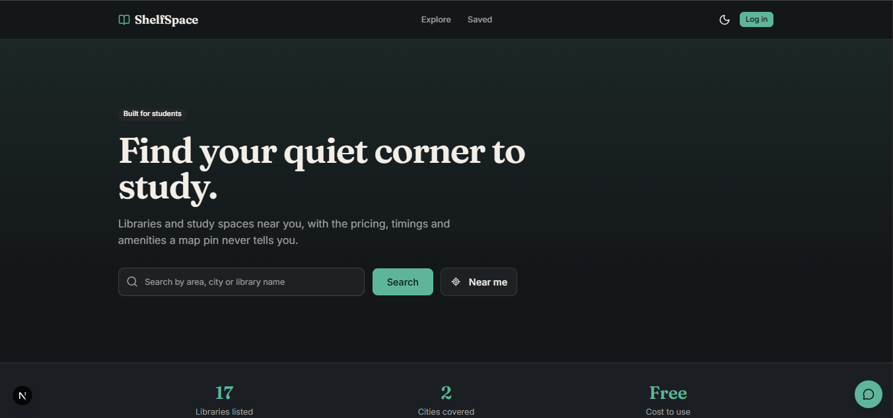

# ShelfSpace

Find libraries and study spaces near you, with the fees, timings and amenities that a map pin never tells you.

**Live demo:** https://shelfspace-v2.vercel.app



> **Data status:** library names and locations are real, imported from OpenStreetMap. Fees, timings and amenities are added only after manual verification, so only a few libraries have them so far. Everything else shows "Not verified yet" on purpose, and the app never presents unverified details as fact.

## Why this exists

General maps list every kind of business. A student looking for somewhere to study needs the monthly fee, day-wise timings, silent zones and lockers, and that information is often missing or available only by phone. ShelfSpace is a focused finder for that one decision.

## Features

- **Search and Near me:** search by name, area or city, or use browser geolocation. Distance is computed with the Haversine formula within a 50 km radius.
- **Filters and sorting:** maximum monthly fee, amenities, an **Open now** filter evaluated in Indian time, and sorting by rating, price or distance. All of it lives in the URL, so searches are shareable and the Back button works.
- **Interactive map:** clustered pins, side by side with the list on desktop and behind a List/Map toggle on mobile.
- **Library detail page:** fee, amenities, day-wise hours with today highlighted, a "last verified" date, a mini map and directions.
- **Accounts:** email and password sign-up, login, logout and password reset, using Supabase Auth with cookie sessions.
- **Saved libraries per account:** stored in PostgreSQL and protected by Row-Level Security. Guests can save locally, and those saves merge into the account on login.
- **Compare:** up to 3 libraries side by side, through a shareable link.
- **Similar libraries:** content-based recommendations (Jaccard similarity on amenities, plus price) on each detail page.
- **AI assistant:** a chat widget that answers only from the database contents and says "I don't have that information" otherwise.
- **Accessible and responsive:** dark mode, keyboard support, labelled controls, reduced-motion support, custom 404 and error pages.

## Architecture

```
OpenStreetMap ──► Overpass API ──► ingestion script ──► Supabase PostgreSQL
                  (mirror failover)  (idempotent upsert)  ├─ libraries           (auto-fetched facts)
                                                          ├─ library_details     (manually verified)
                                                          └─ saved_libraries     (per user, RLS)
                                                                   │
Browser ◄── Next.js (App Router, server components) ◄──────────────┘
   │             ├─ data-access layer (lib/data)
   │             ├─ session-refresh proxy (Supabase SSR cookies)
   │             └─ /api/ai-chat ──► Gemini (grounded on database records)
   └── Supabase Auth (signup, login, password reset via PKCE)
```

### Data model and security

| Table | Purpose | Who can read | Who can write |
|---|---|---|---|
| `libraries` | Name, address, coordinates from OpenStreetMap | Everyone | Ingestion script only (service role) |
| `library_details` | Fee, timings, amenities, last-verified date | Everyone | Manual verification |
| `saved_libraries` | One row per (user, library) bookmark | Only the owner | Only the owner |

Auto-fetched facts and manually verified details are kept in separate tables on purpose, so unverified data can never be mistaken for verified data. The owner column defaults to `auth.uid()` in the database, so the app never sends a user id the client could forge.

## Tech stack

| Layer | Choice | Why |
|---|---|---|
| Framework | Next.js (App Router) and TypeScript | Server rendering, file-based routing, type safety |
| Database and auth | Supabase (PostgreSQL, Auth, Row-Level Security) | Security is enforced in the database, not only in app code |
| Styling | Tailwind CSS and shadcn/ui | Accessible components that live in the repo |
| URL state | nuqs | Type-safe, shareable search state |
| Forms | React Hook Form and Zod | One schema for validation rules and types |
| Maps | Leaflet, OpenStreetMap tiles, marker clustering | Free, no API key or billing |
| AI | Google Gemini, grounded in database records | Free tier; grounding prevents invented libraries |
| Hosting | Vercel | Automatic deploys from `main` |

## Engineering decisions

- **Data-access layer:** pages call `searchLibraries()` and similar functions, never the database directly. I moved from sample data to Supabase by changing those functions only.
- **Idempotent ingestion with failover:** the OpenStreetMap importer upserts by a stable id, so it is safe to rerun. The public Overpass server often returns 502, so it retries on mirror servers.
- **Time-zone-safe "Open now":** servers run in UTC, so opening hours are evaluated in `Asia/Kolkata`, including hours that pass midnight.
- **Honest data:** a library without a verification date says "Not verified yet".
- **AI used where it fits:** the chat assistant is grounded on database records. Recommendations use plain set-similarity math, because that needs no model.
- **Optimistic UI:** bookmarking updates the screen instantly and rolls back if the database refuses.
- **Auth details:** a proxy refreshes sessions, password reset uses PKCE, reset responses don't reveal which emails have accounts, and redirect targets are validated.

## Performance and accessibility

PageSpeed Insights, mobile, on the production deployment, measured on DD Mon YYYY:

| Performance | Accessibility | Best Practices | SEO |
|---|---|---|---|
| XX | XX | XX | XX |

## Getting started

Requires Node.js 20+ and a free [Supabase](https://supabase.com) project.

```bash
git clone https://github.com/shubhitiwariiii/shelfspace-v2.git
cd shelfspace-v2
npm install
cp .env.example .env.local      # then fill in your values
```

1. In the Supabase SQL Editor, run `supabase/schema.sql`.
2. In Supabase **Authentication → URL Configuration**, add `http://localhost:3000/**` to the Redirect URLs.
3. Import real libraries: `npm run fetch:osm`
4. Start the app: `npm run dev` and open http://localhost:3000

| Variable | Used for | Keep private? |
|---|---|---|
| `NEXT_PUBLIC_SUPABASE_URL` | Supabase project URL | No |
| `NEXT_PUBLIC_SUPABASE_ANON_KEY` | Public key, limited by Row-Level Security | No |
| `SUPABASE_SERVICE_ROLE_KEY` | Ingestion script only. Bypasses security rules | **Yes. Never deploy it** |
| `GEMINI_API_KEY` | AI assistant | **Yes** |

## Project structure

```
src/app/            routes: explore, library/[id], compare, dashboard, login, signup,
                    forgot-password, reset-password, auth/callback, api
src/components/     UI components (ui/ holds shadcn components)
src/lib/            data layer, Supabase clients, auth, search params, open-now logic
scripts/            OpenStreetMap ingestion script
supabase/           database schema
```

## Known limitations and roadmap

- Few libraries have verified fees and timings. An owner or admin verification flow is the main next feature.
- The AI chat route has input caps but no per-user rate limiting.
- Password-reset emails use Supabase's built-in sender, which is limited. Production would use custom SMTP.
- No automated tests yet. Next: unit tests for distance and open-now logic, and end-to-end tests for login and saving.
- Reviews and ratings, and more cities.